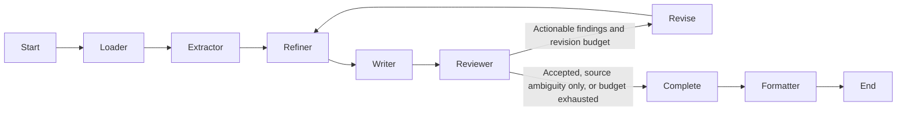

# Requirements refinement network — final design

The network comprises deterministic corpus loading and four LLM agents: Extractor
(`gpt-5-mini`), Refiner (`gpt-5.6-luna`), Writer (`gpt-5.4-nano`) and Reviewer
(`gpt-6-luna`). Configuration can change model names but must retain at least three
distinct names. A deterministic formatter produces the single Markdown document.

The implementation uses `StateGraph`, ordinary edges and conditional edges,
following the [LangGraph Graph API](https://docs.langchain.com/oss/python/langgraph/graph-api).
State uses replacement updates without append reducers. Review history alone is
explicitly copied and extended. Revision state replaces stale requirements,
blacklist, dispositions, glossary and conflicts. Original evidence remains available.

The Reviewer checks OS2–OS9 against the full normalized corpus, not just extracted
candidates or polished prose. All issue targets and evidence must validate. A
corpus requirement missed by extraction can enter the next pass as a validated
candidate, with the same deterministic ID scheme as extraction. Issue IDs hash
canonical findings. Repeat wording yields stable IDs; semantic identity across
rewrites is not inferred deterministically.

Every review classifies findings as actionable quality defects or unresolved source
ambiguities. Accepted results have no findings; acceptance with unresolved sources
has only non-actionable findings. Missing candidates always require revision. Every
known unresolved conflict must be addressed by an OS7 finding. Unresolvable source
questions request disclosure/clarification, never fabricated business decisions.

The initial pass uses revision count zero. A deterministic feedback node increments
it once before Refiner runs. With the default maximum three, Refiner/Writer/Reviewer
run at most four times. Completion distinguishes `complete`,
`complete_with_unresolved` and `incomplete_review`, preserving the latest findings,
unincorporated candidates and separate unresolved source/quality issue lists.
This gives the formatter enough information to disclose limitations.

LangGraph's recursion limit is independently sized to `10 + 4 * max_revisions`.
Seven nodes execute initially, with four more per feedback cycle. Validation/transport
retries are separately bounded by the existing LLM client. An API or validation
failure raises an error rather than pretending the review completed.

Graph compilation and import are offline. Actual graph invocation requires API
credentials or an injected mocked client. Tests run real graph and node logic with
mocked generation, checking ordering, exact revision limits and state preservation.

Semantic correctness remains best effort. The basic node interfaces retain ordinary
Pydantic records. Full-corpus mode adds a compact wire adapter and recovery layer,
without changing agent responsibilities or relaxing structural validators.

The deterministic Formatter validates ledger integrity, evidence, priorities,
review counters/history and completion status, then assigns readable final IDs by
sorted internal key. One ID mapping drives detail headings, blacklist relationships,
unresolved conflict/issue targets and the traceability table. Internal keys remain
separate. HTML and Markdown syntax in supplied text is escaped. Evidence excerpts
retain their original contents rather than replacing identifiers inside quotations.

The document includes overview/counts/status, priorities, requirements, glossary,
blacklist, unresolved findings, traceability and source inventory. Structural defects
abort output; unresolved semantic defects and coverage gaps are disclosed. Missing
review-discovered candidates that could not be incorporated remain visible.

`complete` classifies termination; `formatter` renders and optionally writes before
END. API-free graph compilation and memory-only rendering remain supported. The
CLI requires an explicit output path and validates configuration/credentials before
running the graph. It emits progress and counts, not corpus text or credentials.

Output safety is checked before model calls and again at write time. Corpus files
cannot be replaced. An explicitly allowed new output inside the corpus is excluded
from ingestion; existing files there remain protected. Parent directories are
created on success, and a same-directory temporary UTF-8 file is flushed and
atomically replaced to avoid partial documents. External concurrent filesystem
changes are not synchronized by a locking service.

For the full run, evidence is sent once in an ID catalog instead of copied into
every candidate/requirement/rejection. The model groups original candidate IDs;
deterministic expansion restores full keys, exact source-reference unions, original
blacklist statements and one disposition per candidate. Large candidate collections
are partitioned completely into topical batches of at most 36, then refined into
atomic requirements. Partition coverage is validated and batches share a glossary.
Reviewer-discovered candidates are allocated once rather than repeated in every
batch. The global critic still checks cross-batch duplicates. Writer prose is generated
in batches of 20 with the shared glossary. The reviewer still sees the full original
numbered corpus and every current requirement/candidate, enabling global coverage
and contradiction checks. All compact results pass the original validators.

Each actual request is cost-reserved before sending, cached by model/prompt/schema,
and entered into an on-disk usage ledger. Successful graph-stage snapshots include
full state and the next entry point, allowing recovery at extraction, refinement,
writing, review, revision bookkeeping or formatting. Request caching also handles
failures inside multi-request nodes. Source fingerprints and model/output identity
are checked before resuming. Serial execution is required for a run directory.

The configured EUR 30 budget is an estimated software guard with conservative
token bounds and 25% currency/pricing headroom, not a provider-enforced spending
limit. Output allowances are stage-specific, within documented model maxima.
Potential context overflow is checked before a request; semantic/validation failure
does not silently skip a source, candidate or requirement.
