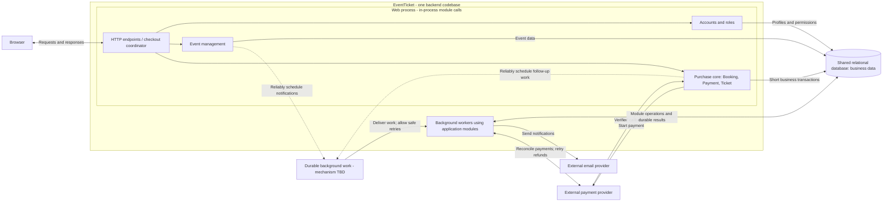

# ADR-001: Modular monolith with durable background workers for EventTicket

- **Status:** Proposed
- **Date:** 2026-11-01

This records the preferred design under evaluation; it has not been formally approved for implementation.

## Context

EventTicket is a web application for discovering events, booking pre-sales and purchasing tickets online. Users manage profiles, purchase history and category preferences; managers publish events; administrators add managers. The system also needs authentication, password recovery and category-based email notifications.

Purchases require consistent inventory allocation, traceable payment outcomes and unique ticket issuance. Concurrent customers must not obtain the same capacity. External payment and email providers can fail or respond late.

The requirements specify no traffic estimates, availability targets or need for independently deployed teams. We therefore prioritize development and operational simplicity, reliable purchases, maintainability and a practical path to scale. Inventory limits and expiring purchase holds are working design assumptions; their exact business rules remain to be agreed.

## Decision

Propose a **modular monolith with durable background workers**: one backend codebase, one relational database for business data and worker processes using the same application modules. Web and worker processes may run and scale separately without becoming independently owned business services. The durable job mechanism remains to be selected.

### Architecture overview

**Request flow:** The browser calls the web endpoints, which coordinate direct module calls. The purchase core reserves capacity and creates a pending order in a short database transaction, then initiates payment outside that transaction. A verified provider callback confirms a still-valid reservation, records the payment and creates ticket records atomically. The browser retrieves purchase status and issued tickets from the backend.

**Background flow:** Committed business changes reliably schedule notifications, reservation cleanup or payment recovery. Workers execute that work through module interfaces and record results and retries durably; failed email delivery does not undo a purchase. The background-work box is a logical capability, not a commitment to a separate server or broker. Its implementation must prevent a crash between committing a business change and scheduling work from silently losing that work.

### Architectural commitments and reliability requirements

- Organize accounts/roles, events, bookings/inventory, payment integration, tickets and notifications into modules with owned tables and explicit public interfaces. Use in-process calls for immediate operations; prevent other modules from bypassing interfaces to change owned data.
- Keep bookings, inventory, payment records and ticket issuance within one local transactional boundary. Coordinate short cross-module transactions explicitly rather than assuming method calls provide atomicity.
- Reserve capacity and record the pending order atomically, preventing overselling under concurrent requests. Keep database transactions short and complete them before external payment operations or customer interaction.
- Process verified payment callbacks idempotently. Confirm a valid reservation and create ticket records in a local transaction. Coordinate confirmation and expiration so only one can win. A payment received after capacity has been released must enter a durable recovery/refund workflow rather than revive an expired reservation.
- Run notifications, reservation cleanup, payment reconciliation and refund retries as durable background work. Scheduling must survive crashes and temporary outages without silently losing required work.
- Repeated job delivery must not duplicate business effects. Provide controlled retries, visibility of failed work and a recovery path. External effects are not guaranteed exactly once.

Payment-provider operations remain outside database transactions. Stable operation identifiers, provider verification and reconciliation are required even within a monolith. Customers must be able to retrieve issued tickets without depending on successful email delivery.

### Implementation choices left open

- **Concurrency control:** Row locking and conditional atomic updates are possible techniques, not selected solutions. Evaluate them against the seating model and measured contention while preserving atomic allocation.
- **Durable work:** Evaluate database-backed jobs and broker-backed messaging against delivery guarantees, scheduling needs, operating cost and expected load. A transactional job record or outbox is a possible way to connect business commits to work delivery; the database and queue must not be treated as an unprotected pair of writes.
- **Operational details:** Worker claiming/acknowledgement, retry timing, failed-work storage and deployment sizing belong in detailed design or a focused ADR where their trade-offs warrant one.

## Alternatives considered

The proposed design combines the structural foundation of option 1 with selective background processing from option 3:

| Approach explored | Main contribution | Relationship to the decision |
|---|---|---|
| 1. Primarily synchronous modular monolith | Explicit modules, direct calls and local transactions; simple deployment and testing | **Adopt its structure.** Keep immediate purchase decisions local and add durable workers for secondary work |
| 2. Microservices with service-owned data | Independent releases, ownership and scaling; potential failure isolation | **Defer.** Distributed workflows and operations exceed demonstrated needs, especially for the cohesive purchase core |
| 3. Event-driven web-queue-worker | Separate request handling from durable asynchronous work; scale workers and buffer bursts | **Adopt selectively within the monolith.** Use durable background work; leave its technology open and defer queued reservation requests until justified |

These alternatives overlap: monolith versus microservices concerns application boundaries, while event-driven concerns communication. Web-queue-worker is a compatible deployment pattern, not a mutually exclusive structural alternative. The decision deliberately combines modular organization with selective asynchronous processing; it does not require event sourcing.

## Consequences

### Benefits

- Local transactions simplify reservation and ticket consistency and reduce distributed recovery paths.
- One codebase and clear module boundaries make development, refactoring, debugging and testing manageable.
- Durable workers isolate slow notification work and allow recovery after temporary failures.
- Stateless web instances, cached browsing and independently scaled workers provide incremental scaling options.

### Costs and risks of the proposal

- Business modules generally release together; the application and database remain shared failure domains. Module boundaries require ongoing enforcement.
- A popular event's inventory can remain a contention point. Additional application instances or queues do not eliminate that serialization. Load testing, short transactions, bounded connections and admission control may be needed.
- Background results can be delayed. Job backlogs, retries and failed work require monitoring and recovery procedures; intake may need throttling during prolonged outages.
- External payment uncertainty, expiration races and refunds still require explicit state transitions and operational intervention for unresolved failures. Email retries can duplicate delivery unless the provider supports suitable idempotency.

## Validation and review

Test purchase rules, real database concurrency and rollback behavior, duplicate callbacks/jobs, crashes around commit and acknowledgement, payment-versus-expiration races, refund recovery and notification failure. Use focused component tests plus a smaller end-to-end suite, provider-sandbox checks and load tests.

Revisit service extraction when measured workloads, independent team releases or isolation requirements justify the cost. Notifications or catalogue/search are potential first candidates; preserve one authoritative inventory allocation boundary.

Before detailed implementation, clarify pre-sale semantics, general admission versus numbered seating, hold duration, late-payment/refund policy, and expected traffic and availability targets. This ADR does not select a framework, database product, payment provider or hosting platform.

## Related records

- [EventTicket requirements](../data/EventTicket.txt)
- [Task 1 architecture discussion](Task_1_conversation_notes.md)
- [Task 2 ADR discussion](Task_2_conversation_notes.md)
