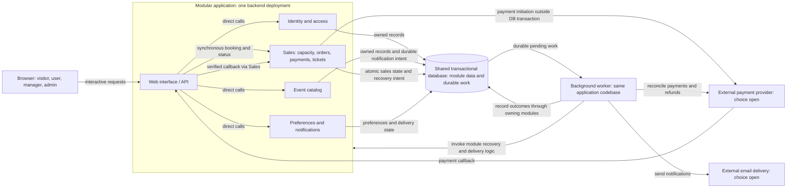

# ADR 001: EventTicket modular application with durable background recovery

- Date: 2026-11-01
- Status: **Proposed**
- Scope: architecture evaluation; no implementation or formal adoption implied.

## Context

[EventTicket requirements](../../data/EventTicket.txt) describe a web application for event discovery and online ticket distribution. Visitors browse, register and log in (stories 1–4). Users access personal data, select favourite categories for email notifications, book and view pre-sales, buy and view tickets, pay online and obtain ticket codes (5–11). Managers publish and view their events (13–15); administrators add managers (17). Personal pages, logout and password recovery complete the role/access requirements (12, 16, 18–20).

For this evaluation, pre-sales **may temporarily reserve limited capacity**; this is an assumption, not a confirmed source requirement. The user accepts pending payment status and requires eventual resolution to a ticket or refund without overselling, duplicate tickets or untracked payments. Traffic, team size, budget and numeric availability/performance objectives remain unspecified.

Decision drivers are correct concurrent purchasing, recovery from uncertain external payments and issuance failures, comprehensible customer status, and proportionate operational complexity. Independent team ownership and asynchronous booking acceptance have no established requirement. Expiry policy remains unresolved.

## Proposed decision

Use **architecture A: a modular application with one shared transactional database and durable background processing**. Initial booking checks and records allocation synchronously; it is not accepted into a queue for later allocation. Payment may still remain pending after this response.

### Boundaries and ownership

- **Identity and access:** registration, sessions, role checks, personal data and password recovery. Enforce manager/admin privileges and ownership checks on the server.
- **Event catalog:** event publication, discovery and manager event ownership.
- **Sales:** authoritative capacity, reservations, orders, payment/refund state and ticket entitlements/codes. These remain in one local transaction boundary.
- **Preferences and notifications:** favourite categories, notification selection and delivery tracking.

Modules communicate through internal interfaces and own their logical records; sharing a database does not authorize arbitrary cross-module writes. Sales controls allocation and finalization even when other modules display availability. The web backend is one deployment unit. Background workers use the same application codebase and database, and may run as separate processes from the same release; process layout remains open. Payment and email delivery are external dependencies; providers are not selected.

### Architecture diagram

The diagram shows logical responsibilities; worker-to-database operations use owning-module logic. No message broker, database product or worker framework is selected. Callback verification and state transitions belong to Sales; worker reconciliation covers missed or ambiguous callbacks.

### Key commitments and purchasing flow

1. **Synchronous allocation:** validate authorization and sale eligibility, atomically claim available capacity and create the reservation/order, then return its durable identity and status. Availability shown during browsing never grants capacity. Under the capacity assumption, active holds plus sold tickets cannot exceed capacity; changing event capacity must also preserve this invariant.
2. **Recoverable payments:** durably record payment attempts before contacting the provider, with stable identities for safe retries and reconciliation. Do not hold a database transaction open across provider calls. Verify callback authenticity and payment/order correspondence. A timeout means unknown outcome, not proof of failure.
3. **Atomic local issuance:** after verified payment and a valid allocation, commit order finalization, conversion of held capacity to sold capacity and ticket entitlements together. Repeated requests/callbacks return the existing result and cannot create duplicate entitlements. Ticket delivery or rendering does not create a new entitlement.
4. **Durable background obligations:** persist notification and recovery intent consistently with the state changes requiring it. Work must survive process failure and support safe retry, concurrent execution and restart. A specific job table, outbox or broker mechanism is not prescribed. Notifications do not block booking; failed recovery work is retained and escalated rather than silently discarded.
5. **Policy-independent safety:** expiry, payment confirmation and finalization arbitrate against authoritative reservation state. Support either releasing capacity at expiry with tracked late-payment refunds, or retaining capacity during payment uncertainty. Released capacity cannot be revived blindly; reacquisition requires a new atomic capacity check. Timestamp and expiry semantics require a business decision before implementation.
6. **Tracked resolution:** separately track reservation, payment/refund and entitlement outcomes. Every discovered successful charge must lead to an entitlement or a durably tracked refund obligation. Reconcile unknown outcomes with the provider, retry safely and support operator intervention. Customers can distinguish pending payment, ticket ready and refund pending, and retrieve existing tickets without email delivery.

### Required failure behavior

| Scenario | Required outcome |
|---|---|
| Two customers seek the last ticket | One atomic allocation wins; the other receives unavailable status. Retrying the winner's request does not allocate again. |
| Confirmation arrives after expiry | Apply the eventual expiry policy against current authoritative state; never oversell. If payment cannot yield a ticket, retain and resolve its refund obligation. |
| Crash before local issuance commits | No partial local finalization; recover payment state and retry safely. |
| Crash after commit but before response | Return the already created entitlement on retry. |
| Charge or refund succeeds but its response is lost | Reconcile using the recorded attempt identity; do not blindly repeat the financial effect. |
| Email or worker unavailable | Preserve existing tickets and durable work; show pending status where appropriate and recover after restart. |

These are required outcomes, not proven implementation guarantees. Provider support for duplicate-safe operations and outcome lookup must be validated.

## Alternatives considered

| Criterion | A: Modular application | B: Independently deployed domain services | C: Queued booking with separate read views |
|---|---|---|---|
| Boundaries/data | Modules share a transactional store; Sales owns purchasing | Services own private stores; inventory/orders/tickets remain together in Sales | Durable commands feed authoritative sales workers; separate query views |
| Communication | Direct calls; external APIs; background work | Network APIs and durable inter-service events | Asynchronous booking commands/events; synchronous status queries |
| Purchasing reliability | Local arbitration plus external-payment recovery | Same local sales guarantees, plus network and event-publication recovery | Same allocation invariant, plus redelivery, ordering and projection recovery |
| Scaling and availability | Shared database and application failure boundaries | Independent scaling/releases where boundaries allow; Sales still a bottleneck | Buffers bursts and separates reads; backlog grows if processing cannot keep up |
| Maintainability | Internal boundary discipline; coordinated releases | Explicit contracts and ownership; distributed business consistency | Explicit workflows; more processing states and query-model maintenance |
| Testing/operations | Concurrency, crash and provider recovery; fewer components | Adds contract/network tests, deployments and distributed diagnosis | Adds replay/backlog/stale-view tests and queue/projection monitoring |
| Hardest work | Payment ambiguity, expiry races and durable recovery | Reliable publication and cross-service eligibility/state coordination | Duplicate-safe workers, delayed outcomes and view rebuilding |
| Disposition | Preferred proposal for current evidence | Prefer if independent ownership/releases or demonstrated isolation/scaling needs justify overhead | Prefer if durable asynchronous booking acceptance or separate query scaling becomes necessary |

The axes overlap: B can use C's processing model, while A can run durable background jobs. Background notifications/recovery alone do not turn A into queued initial booking. Neither service decomposition nor queues strengthen the sales invariant automatically. No current requirement establishes a compelling reason to incur B's or C's added coordination costs; this is not a measured performance comparison.

## Consequences and accepted trade-offs

- Local purchasing transactions and fewer deployments simplify reasoning, while module discipline preserves logical responsibilities.
- Shared database contention, common failure impact and coordinated releases are accepted. Worker separation reduces process interference but does not remove shared database/resource bottlenecks.
- Durable recovery adds real operational work: monitor unresolved payment/refund age, job failures/backlog and notification delays; provide audited recovery actions and database backup/restore procedures.
- No architecture guarantees a prompt ticket/refund during permanent provider unavailability. Eventual resolution depends on recoverable provider access and operational intervention; obligations must remain visible throughout.
- No throughput, availability or recovery-time claim has been established. Provider behavior and database recovery remain critical dependencies.
- Required verification includes last-ticket concurrency, expiry/confirmation races, duplicate callbacks, crashes around commit and job completion, lost charge/refund responses and worker restart. Restore/reconciliation exercises must account for external payments that outlive a database failure. These checks are planned, not executed.

## Unresolved rules and implementation choices

**Business rules:** confirm pre-sale meaning, capacity model and assigned seating; choose expiry/release policy, duration and relevant timestamps; define late-payment reacquisition/refund rules, customer notices and escalation expectations. Broader cancellation/refund rules and event-change behavior are unspecified. Traffic, team size and service objectives remain open rather than estimated.

**Implementation choices:** database and isolation/concurrency mechanisms; languages/frameworks and hosting; worker placement, durable-work storage and scheduling; retry/backoff and monitoring tools; payment/email providers; authentication/session and ticket-code mechanisms. An external ticket issuer is not assumed; adding one requires separate consistency/recovery evaluation. Provider reconciliation, refunds and safe retry capabilities must be demonstrated before purchasing behavior can be validated.

## Validation and review triggers

Review this proposal when workload evidence reveals database contention or unacceptable shared failure impact; independent teams require autonomous releases; queued initial booking becomes a product requirement; or provider/external-issuance constraints invalidate the assumed recovery model. Define measurable objectives before evaluating performance. Resolve business policies and pass the failure tests before claiming purchasing guarantees in an implementation.

## References

- [Requirements](../../data/EventTicket.txt)
- [Architecture conversation and scenario analysis](architecture_conversation_notes.md)
- [ADR drafting and review notes](adr_review_notes.md)

This evaluation uses the requirements and new discussion only; previous EventTicket architecture notes and ADR were excluded.
